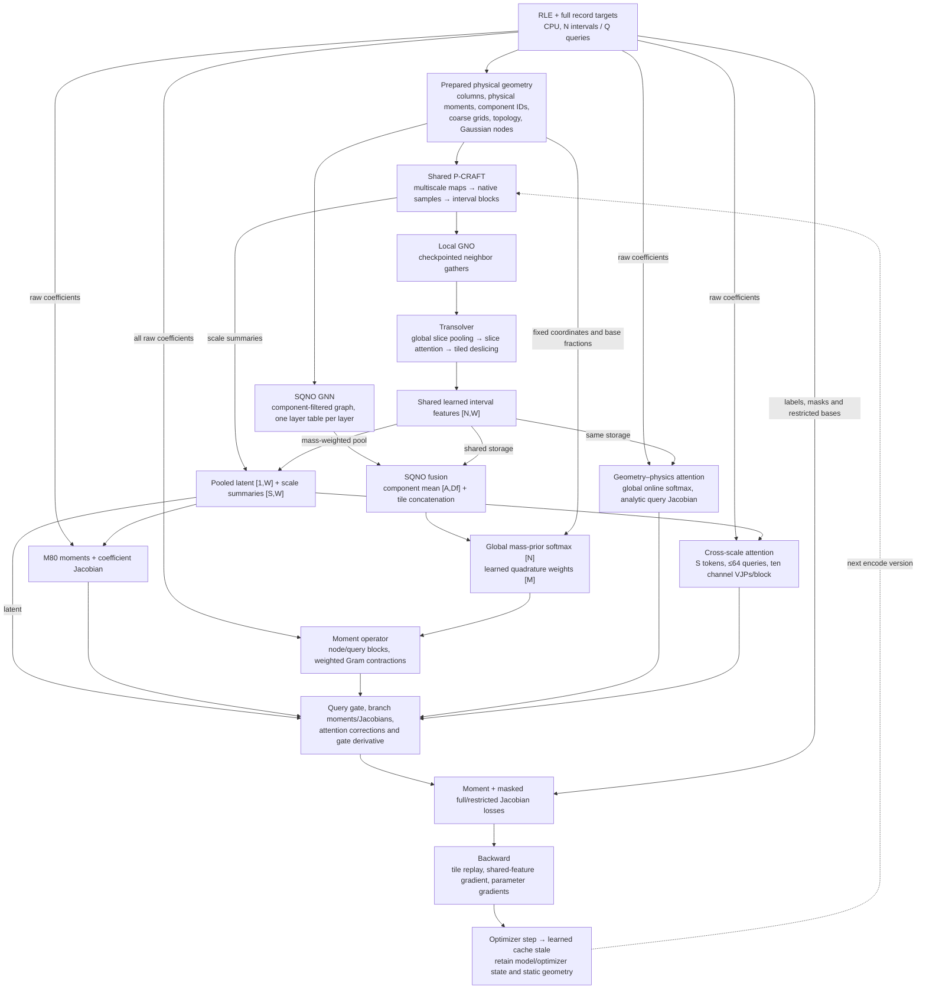

# Full V1 geometry, query and backward memory

The model encodes a native RLE geometry once per optimizer version. M80 reads the pooled latent. SQNO fusion and geometry–physics attention read the same learned interval table when their device and dtype match. A training update invalidates those learned values. Physical quadrature coordinates, conservative grids and topology remain reusable through a caller-owned prepared geometry.

## Storage across one update

| Lifetime | Materialized tensors | What controls release |
| --- | --- | --- |
| Prepared host geometry | Read-only physical arrays, per-scale conservative grids, component IDs, keyed neighbor maps and quadrature coordinates/base weights | The prepared owner controls lifetime. Entries depend on geometry and construction options, and can span optimizer versions. |
| One encoder graph | Multiscale feature maps and sampled tables, full interval/GNN layer tables, node masses and component means | Saved inputs and split views can retain complete source storage. The GNN final table is also the final list entry. Releasing a Python list frees only its references. |
| One tile or replay | GNO neighbor features and edges, Transolver assignments, SQNO fusion concatenations, geometry-attention K/V and score tangents, node-block basis and Gram operands | Non-reentrant checkpoints or the analytic attention VJP reconstruct the corresponding intermediates during ordinary training backward. Concatenation can briefly overlap the incoming chunks and their joined output. |
| One query batch | M80/SQNO moments and raw Jacobians, attention outputs and sufficient statistics, query gate, valid-label projections | The scalar loss references active outputs through backward. Detaching diagnostics prevents them from keeping their production graph alive. |
| Across updates | Model parameters, optimizer buffers and optional prepared host geometry | The normal loop releases per-record references after the step. Preflight keeps the stale cache just long enough to verify rejection, then deletes it before restoring the checkpoint. |

## How the boundaries changed from a21a200

- **P-CRAFT / GNO.** Previously a checkpoint received the already gathered `[C,K,W]` neighbor features. Across all target tiles those inputs retained edge-sized feature copies until backward. The current checkpoint receives source-tile views, builds edge descriptors inside the tile and gathers the local neighborhood on replay. A split view still retains its source storage. Sampling each learned spatial map once produces a full `[N,P]` table per scale and one map adjoint per scale.
- **Transolver.** Both revisions pool assignment-weighted contributions over all intervals and attend over global slices. The current code recomputes point assignments for deslicing and backward. Slice mass, slice tokens and the full output interval table persist. Enabling adaptive slicing also replays FP64 per-tile energy and variance statistics.
- **SQNO GNN and fusion.** Each layer supplies `[N,D_l]` values to the weight head. A target block references its distinct source blocks and the global layer mean. Fusion gathers component means for active rows and builds its concatenated MLP input in the checkpoint. The default full-model path keeps individual layer outputs; the standalone v1.1 concatenated-feature API remains available.
- **Geometry–physics attention.** One tile's K/V projection serves all query blocks. Online reductions cover every interval with the physical log-mass prior. The custom Function saves q, its raw-coordinate tangent, a shared feature reference, the prior, weights and query-sized sufficient statistics. It reconstructs probabilities from the global log partition during backward. The analytic correction Jacobian replaces the previous ten output-row VJPs over the interval graph. Training the encoder still requires a full `[N,W]` gradient.
- **Cross-scale attention.** Each block of up to 64 independent queries attends to all valid global scale tokens. Ten differentiated channel sums give the ten raw-query Jacobian rows for every query in that block. The forward also supplies detached diagnostics. The full preset uses three scales.
- **SQNO integration.** With `M=N×order³`, per-node coordinates and learned weights remain dense. The baseline allocated a `[J,B,10,10]` Hessian inside its checkpointed node tile. The new contractions use `[B,J,10]` operands and produce two `[B,10,10]` weighted Grams. Raw-coefficient normalization and the fixed-moment contribution remain in the physical path.
- **Training and preflight.** Fixed mode accumulates one backward on the weighted tasks. AdamW state persists. Preflight keeps the parameter-change snapshot on CPU and validates a separately restored model/optimizer/scheduler. Checkpoint predictions use fresh inference encodes with the prepared geometry. The update peak and later restore/verification peaks use distinct profiler boundaries.

The standalone SQNO cache validates its own parameter version and the version of a supplied P-CRAFT feature producer. An implicit no-grad encode of trainable geometry is rejected for unified training. Deliberately frozen geometry can supply trainable query heads.

## Evidence and interpretation

A CPU execution of the comparison fixture used nine native intervals, three queries and two scales. At encoder return, 28 cache tensor fields occupied 25 distinct storages. Logical field sizes summed to 4,308 bytes and the distinct storages totaled 3,980 bytes. The local interval features, global context and global scale weights each had a shared storage in the two caches. These figures describe the cache fields of the small fixture. Autograd-only buffers, workspaces and allocator reservation require separate measurements.

The JSON inventory records shapes, dtypes, graph attachment, aliases and release boundaries, alongside the CPU observations. Use the real-record profile's `encode_geometry.cache_storage`, tensor observations, stage peaks and replay counts to inspect production behavior. Allocator peaks are inclusive of live inputs to each region. Summing overlapping peaks double-counts storage. [Tensor inventory](tensor_retention_inventory.json) · [Nine-module audit](memory_lifecycle_audit.json) · [Real-record profile](memory_profile.json) · [Peak analysis](peak_memory_profile.md)
