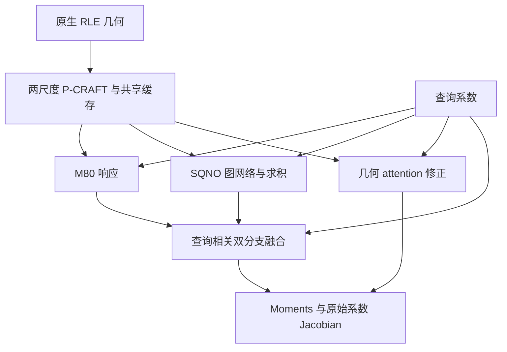

# Phase 3.2.2 — 神经算子精简实现与 Work 执行指令

日期：2026-11-24（北京时间）。开发分支：`research/phase3-2-chat-v1-optimization`。

交付入口：用户已明确授权将本轮源码、测试和 Work 文档发布到 `volcano-code/TVCG`，研发分支为 `research/phase3-2-chat-v1-optimization`，对应 PR #1。Work 优先按第 5.1 节从该分支建立独立 worktree；早先的 `TVCG_Phase3_2_2.bundle` / `TVCG_Phase3_2_2.patch` 保留为离线交付备选。

## 1. 本轮交付与判断边界

本轮已在模型、配置工厂和训练入口落实精简，新增可独立训练的 `compact_v1_candidate`。原 `full_v1_candidate` 和 `reference_v1` 的默认结构与配置指纹保留。当前默认训练配置仍为 Full V1；精简候选须显式指定，待配对实验通过后再决定正式训练主配置。

本轮完成的是结构删减、模块开关解耦、共同随机初值和实验执行入口。CPU 验证不能证明真实数据上的精度、RTX 5090 D 的训练加速或优化器轨迹成功率。所有新增配置仍标记为 `candidate_configuration_not_performance_validated`。

### 已吸收的 Work 意见

- `CHAT_HANDOFF(3).md` 与 `Phase2_12_长训练方案_Chat审核.md`：保持数据版本、训练集 RMS、Full-J/R3/R8 有效掩码、来源组隔离与固定基准锁定。历史正式 Pilot 为 46 个训练几何、2,546 条 Moment 查询；严格开发集 15 个几何、14 个来源组、122 条查询。此为交接文件记录，Work 须对本次实际 manifest 重新核验。
- `TVCG_Phase2_12_Operator_Work_Checklist.md`：保留历史 Full V1 实验，不同时改变架构、教师、损失和划分。用户现已授权新架构精简，因此在独立实验目录进行，不覆盖历史 Pilot 或长训练。
- `CHAT_REPLY.md`：SDF/occupancy 边界不一致的隔离项继续隔离；网络改造不构成降低数据准入标准的理由。
- Phase 3.2.1 已记录的 Work B 反馈：native cut 语义差异、真实轨迹 Jacobian 误差、低保留率改善与高保留率退化必须分别核验。本轮没有重新获得并复算 Epoch 36 权重、24 条真实轨迹或新教师，不能声称这些问题已解决。

这些文件中旧的三轮学习率 Pilot、Epoch 3 续训与本轮从头架构比较属于不同实验。本轮固定 `lr=3e-5` 是新的短程筛选设置，不复用旧续训调度器，也不声称是最优学习率。

## 2. 精简后的结构

| 组件 | Full V1 | Compact V1 | 原因与含义 |
|---|---|---|---|
| 原生 RLE 几何、坐标与十矩顺序 | 保留 | 保留 | 不改变物理对象与标签定义 |
| 共享 P-CRAFT 上下文尺度 | 32 / 64 / 128 | **64 / 128** | 减少一次上下文编码；不是把 RLE1024 降成 RLE128 |
| P-CRAFT 全局/局部尺度 gate | 开 | 开 | 两个尺度仍需融合 |
| 共享编码器 GNO | 开 | **关** | 删除一套局部图消息传递；SQNO 自己的 GNN 仍保留 |
| Transolver physics slicing | 开 | **关** | 删除额外全局交互层，先检验已有 P-CRAFT 表达是否足够 |
| M80 + SQNO 双分支 | 保留 | 保留 | 本轮不同时改变基础物理响应和求积机制 |
| 查询相关的 M80/SQNO 融合 | 保留 | 保留 | raw coefficient Jacobian 的乘积法则项继续保留 |
| Geometry–physics attention | 开 | 开 | 保留查询对原生几何特征的修正通道 |
| Cross-scale attention | 开 | **关** | 去掉额外尺度读出路径 |
| 两 attention 间的 β gate | 开 | **无** | Compact 仅有一个 attention 残差，直接相加 |
| UQ / Event 可训练头 | 开 | **关** | 当前 Moment/Jacobian 训练并未完成这些头的独立监督与校准 |

Compact 的预测关系为：



SQNO 继续使用共享 P-CRAFT 特征、自己的 GNN 和原生求积节点。几何编码仍独立于查询并支持同一几何的多查询缓存。求积阶数保持 2；训练标签、采样和损失权重沿用原配置。本轮所有命名候选均沿用 Full V1 的 bounded-odd 读出，未开启 convex-potential 候选，也不新增凸性保证。

### 参数计数

以下为 CPU 实际构建模型后 `sum(p.numel() for p in model.parameters())`，没有进行真实几何编码：

| 配置 | 参数元素数 |
|---|---:|
| `full_v1_candidate` / `ablation_g1_t1` | 4,302,996 |
| `ablation_g0_t0` | 3,668,618 |
| `ablation_g1_t0` | 3,928,875 |
| `ablation_g0_t1` | 4,042,739 |
| `ablation_no_cross_scale` | 4,073,546 |
| `ablation_two_scales` | 4,302,996 |
| `ablation_one_scale` | 4,182,226 |
| **`compact_v1_candidate`** | **3,351,256** |

Compact 减少 951,740 个参数元素，即 **22.12%**。各配置包含 958,464 个 complex 参数元素；若按实数自由度计，Full 为 5,261,460，Compact 为 4,309,720，减少 **18.09%**。参数元素降幅不能替代运行时或显存实测。三尺度变两尺度不减少参数，因为尺度间共享编码权重；它减少的是一次尺度计算。单尺度还自然移除两种尺度 gate。

## 3. 用于归因的配置

| 配置 | Shared GNO | Transolver | 尺度 | Geometry attention | Cross-scale | 残差混合 | UQ/Event |
|---|---:|---:|---|---:|---:|---|---:|
| `ablation_g1_t1` | 开 | 开 | 32/64/128 | 开 | 开 | gated | 开 |
| `ablation_g0_t0` | 关 | 关 | 32/64/128 | 开 | 开 | gated | 开 |
| `ablation_g1_t0` | 开 | 关 | 32/64/128 | 开 | 开 | gated | 开 |
| `ablation_g0_t1` | 关 | 开 | 32/64/128 | 开 | 开 | gated | 开 |
| `ablation_no_cross_scale` | 开 | 开 | 32/64/128 | 开 | 关 | gated | 开 |
| `ablation_two_scales` | 开 | 开 | 64/128 | 开 | 开 | gated | 开 |
| `ablation_one_scale` | 开 | 开 | 64 | 开 | 开 | gated | 开 |
| `compact_v1_candidate` | 关 | 关 | 64/128 | 开 | 关 | sum | 关 |

四个 G×T 配置来自同一个 native preset，除了两个模块开关外没有混入别的 preset 默认值。`ablation_g1_t1` 是新版显式控制下的 Full 对照；相同 state 的真实小模型测试已确认其计算与旧 parallel Full 完全相同。

新增 `attention_mixing=legacy|sum|gated` 将共享 GNO 与 attention 混合解耦。`gated` 始终为 `beta * R_geometry + (1-beta) * R_scale`。关闭某项只把该项移除，不把剩余项权重重新归一化；同样规则用于 Jacobian。因此 no-cross 试验不会额外将 geometry 残差从 beta 倍放大到一倍。

Compact 同时移除多项并改为单残差 sum，是组合候选，不能用其一次结果归因某个模块。单尺度配置仍有 cross-scale 的 query-conditioned 读出网络：一个 token 的 softmax 为 1，但读出不会因此恒为零或结构性消失；其输出头初始为零，训练后仍可产生随查询变化的修正，不能称为“删除 cross-scale attention”。

## 4. Work A：数据准入先核验

1. 发布本次真实使用的 manifest、资产 hash 与 native-cut 契约。逐项明确保留侧、截断范围、cap/fixed shell、坐标/单位、系数基与十矩顺序；查明历史 analytic cut 与 native discrete cut 的差别。
2. 确认各训练/开发记录的 Moment 与 J 属于同一几何、同一切割语义。Full-J 用 `derivative_valid`；R3/R8 用 `J_pred @ restricted_basis`，分别累计有效分母；moment-only 不补零 J；Event=-1 不作负类。
3. 保持 source-group 划分、训练集 RMS 拟合和固定 benchmark 锁定。开发集是架构筛选集，不应再称独立测试集。若有 calibration reserve，明确其是否已用于选模。
4. 不自动纳入仍隔离的 SDF 边界项。若发布新数据版，所有比较臂统一切换并从共同初值重跑；不把新数据 Compact 与旧数据 Full 直接配对。

现有小数据包可以用于实现验证、反传检查和有限范围的 operator Pilot。只有通过本轮 cut/标签契约核验的记录，才能用于判断真实 native 任务精度。历史 manifest SHA `bbab65fb51840a88c92d4bd814aabd7a6a63ef5b56e4284855b7f473ad447423` 是交接锚点，不是对当前所有语义的自动认可。尚未完成核验时，Work B 继续代码与性能检查，精度实验标为工程诊断，不据此晋级长期训练。

## 5. Work B：取得代码并验证

### 5.1 从 GitHub 同步并使用独立 worktree

在现有仓库执行，避免影响原工作区中的数据、报告和未提交改动。使用新的目录名，兼容已经导入过早期 bundle 的工作区：

```bash
cd /data/xvxinyao/TVCG
git fetch origin \
  refs/heads/research/phase3-2-chat-v1-optimization:refs/remotes/origin/research/phase3-2-chat-v1-optimization
git worktree add --detach /data/xvxinyao/TVCG_phase3_2_2_github \
  refs/remotes/origin/research/phase3-2-chat-v1-optimization
cd /data/xvxinyao/TVCG_phase3_2_2_github
git rev-parse HEAD
git status --short
```

核对 HEAD 与本次发布回执 / PR 的提交一致。若目标 worktree 已存在，换一个新目录，不删除原目录，也不要在已有训练工作区执行强制 reset。

早期离线 bundle 的本地提交为 `68c6de19c1ba26d5d387e2f71802d798fc48951f`，其模型、训练与测试源码与本次发布相同；本次同步说明有所更新，发布提交 SHA 也可能不同。已经导入 bundle 的用户可继续保存旧工作区，在上述新 worktree 中核验公开版本。不要把 bundle / patch 再应用到已经包含本轮代码的 GitHub 版本上。

若需要离线传输，bundle 依赖已在远端的基线 `7a522c589450af3bd472813149bc81aa3dcabea0`；先用 `git bundle verify /实际路径/TVCG_Phase3_2_2.bundle` 检查依赖，再从 bundle 的 `research/phase3-2-chat-v1-optimization` 引用建立独立 worktree。文本补丁则在该基线的新 worktree 中使用 `git am`。两种离线方式任选其一。

计划脚本固定其生成时的 commit。之前在 bundle 版本生成的计划应留在原工作区执行；转到公开版本时使用新的输出目录重新生成，不能手工改 hash 绕过检查。不要将正在进行的训练迁移到另一份代码目录。

使用已能运行本项目的 CUDA Python 环境，不默认沿用发生导入报错时的 `base` 环境。记录 Python、PyTorch、CUDA、GPU 与驱动版本。

### 5.2 运行针对性测试

```bash
TVCG_QROOT=research/NeuralMoments/models/pcraft_ufno/candidate_projects/quadrann_reproduction
env -u PYTHONPATH OMP_NUM_THREADS=1 OPENBLAS_NUM_THREADS=1 MKL_NUM_THREADS=1 \
python -m pytest -q \
  "$TVCG_QROOT/spin_adapter/tests/test_attention_mixing_contract.py" \
  "$TVCG_QROOT/spin_adapter/tests/test_compact_operator.py" \
  "$TVCG_QROOT/spin_adapter/tests/test_unified_factory.py" \
  "$TVCG_QROOT/spin_adapter/tests/test_ablation_initialization.py" \
  "$TVCG_QROOT/spin_adapter/tests/test_jacobian_input_chain_rule.py" \
  "$TVCG_QROOT/spin_adapter/tests/test_jacobian_diagnostics.py" \
  "$TVCG_QROOT/spin_adapter/tests/test_jacobian_diagnostics_unified.py" \
  "$TVCG_QROOT/training_v13/tests/test_simplification_plan.py" \
  "$TVCG_QROOT/training_v13/tests/test_unified_corpus.py" \
  "$TVCG_QROOT/training_v13/tests/test_unified_trainer.py"
```

仓库根目录的 pytest 路径配置已包含 `spin_adapter` 父目录，无需再次手工修改 import。若本机仍无法收集测试，先核对当前 commit、工作目录和 Python 环境，不能把 collection error 当成模型数学测试失败。

### 5.3 生成第一阶段计划

`simplification_plan` 只生成计划与脚本，不启动训练。`--output` 必须是新目录。以下 manifest 路径是交接位置示例；请替换为 Work A 实际验证过的绝对路径。

```bash
TVCG_MANIFEST=/data/xvxinyao/TVCG/phase2_12_dataset/manifest_v2.json
TVCG_RUN_ROOT=/data/xvxinyao/TVCG_runs/phase3_2_2_screen_s830251_github
test -f "$TVCG_MANIFEST"

python -m research.NeuralMoments.models.pcraft_ufno.candidate_projects.quadrann_reproduction.training_v13.simplification_plan \
  --manifest "$TVCG_MANIFEST" \
  --output "$TVCG_RUN_ROOT" \
  --stage screen --epochs 3 --seed 830251 --lr 3e-5 \
  --device cuda --allow-absolute-assets

bash "$TVCG_RUN_ROOT/preflight.sh"
```

`screen` 包含 `ablation_g1_t1`、`ablation_no_cross_scale`、`compact_v1_candidate`。三个 preflight 分别检查几何编码、联合反传与 checkpoint，并留下内存记录。Preflight 使用各配置的构造器初值，只用于执行检查；共同参考初始化用于后面的正式筛选训练。它们通过后，在数据契约核验合格的前提下执行：

```bash
bash "$TVCG_RUN_ROOT/train.sh"
```

生成脚本固定 manifest SHA 和代码 commit，拒绝神经算子源码目录中的未提交或未跟踪改动，并拒绝覆盖已有实验结果；每个臂的终端输出保存在 `console.log`。换数据、切代码或重试失败运行，须在新输出目录重新生成计划。原生大型几何的 smoke 更新可能耗时较长；不为通过 smoke 偷改物理分辨率。可在生成计划时用 `--geometry-id` 选择已知代表性训练几何。

### 5.4 公共参数必须从同一未训练参考复制

每个新训练命令包含：

```text
--initialization-reference full_v1_candidate
```

该选项以相同 seed 在 CPU 构造未训练 Full V1，按名称、shape、dtype 验证并复制目标全部 state，保留原零初始化头。遇到缺失或不兼容项会失败，不静默跳过。它记录参考配置/状态 hash、复制键与仅参考存在的键，不复制训练权重或 AdamW 状态。复制后统一重设训练 RNG，避免可选模块构造造成的随机数消费差异。

`--resume` 与 `--initialization-reference` 不能同时使用。历史 Epoch 36 / Pilot checkpoint 不能改配置名后直接装入 Compact；历史源码指纹检查没有放松。继续旧模型训练应使用其对应历史代码与已有续训流程。

## 6. 分阶段比较，控制算力消耗

| 阶段 | 运行内容 | 用途 |
|---|---|---|
| screen | Full 等价对照、no-cross、Compact；同 seed、3 epoch | 首先判断精简是否具备保留价值 |
| interaction | 四个 G×T 臂；同 seed、相同预算 | 判断 GNO / Transolver 单独收益与交互 |
| scales | Full 等价对照、64/128、64；相同预算 | 判断尺度预算能否进一步缩减 |
| 多种子确认 | 入选候选与 Full；建议至少 3 个共同 seed | 检验结论是否依赖初值 |
| 长训练 / 闭环 | 通过前述检查的配置 | 验证收敛、native 轨迹与求解器实际收益 |

计划参数 `--stage interaction`、`--stage scales` 分别生成后两组；`--stage all` 一次列出 8 个唯一配置。每次使用新目录。第一轮建议只运行 screen，后续根据结果选择需要的归因组，不默认把全部配置长训。后续阶段重复的 Full 对照仅在代码、manifest、seed、训练步数、LR、硬件条件和共同参考 hash 全部一致时才可复用其证据；生成器本身不会偷偷复用旧目录。

为避免“同 epoch 但不同更新数”，比较同时锁定每轮几何顺序、查询集、有效标签数、更新次数、loss 权重、梯度裁剪和调度规则。三轮只是筛选；不能用短程排名推断最终收敛。后续还须分别报告固定更新预算和固定 GPU 时间预算的结果。

## 7. 评估、性能与晋级规则

### 7.1 精度

继续使用 Work 已建立的逐查询导出与来源组复算流程，至少交付：

- 标准化 Moment 的合并 RMSE 与 source-group 等权宏平均；每组样本数、P95 和最差项。
- Full-J、R3、R8 分列，报告各自 mask 与有效标量分母。历史正式开发集的分母为 4,600 / 930 / 1,840，仅在本轮实际数据完全相同时才应一致。
- low / mid / high retention 分层。不能以低保留率改善掩盖高保留率退化；接近零的真值同时报告绝对误差，避免相对误差分母误导。
- 模型返回 J 对最终 Moment 的独立 AD/FD，以及模型 J 对匹配 native 教师的误差。前者通过不能替代后者。
- 真实轨迹查询的 `Jv` / Newton 方向误差、闭环成功率、求解器迭代数与 fallback 次数。

当前通用 V13 训练器仍按 pooled Moment 指标保存 `best_val`，restricted 指标也仍有合并汇总。本轮没有修改其旧选模规则。**不能直接把该文件名当作本轮最终入选模型**；需用 Work 的来源组、三类 J 与 retention 复算报告选择。初筛优先比较固定末轮 checkpoint；若要按来源宏平均从各 epoch 选模，Work 必须逐轮额外归档不可覆盖的 checkpoint，并对所有臂采用同一预先锁定的规则。

### 7.2 性能

固定同一 GPU、dtype、chunk 参数、几何和查询数，分别记录：

1. 首次几何编码（含图构建与缓存）、已有几何缓存上的 Moment/J 查询；
2. 训练 forward、Jacobian / 高阶反传、optimizer step 与完整每几何更新时间；
3. CUDA peak allocated / reserved、CPU 峰值内存与 OOM；
4. 网络加求解器主路径、独立最终验收 / fallback、包含全部环节的总耗时，分别列出。

使用 CUDA events 或前后同步后的计时；报告冷启动和预热后至少 5 次测量的中位数与范围。profiling 本身有额外开销，正式吞吐比较应包含不带 profiler 的计时。不要把单个 Transolver forward 耗时当作整体训练节约，也不要把 22.12% 参数减少写成 22.12% 训练提速。

### 7.3 本轮建议预先固定的工程判据

以下是本轮筛选规则，不是已得到的实验结论：

- 数值、掩码、cache 失效、checkpoint、AD/FD 契约均通过；native 标签语义已匹配。
- 相对同预算 Full 对照，source-macro Moment、Full-J、R3、R8、high-retention 主指标分别不恶化超过 5%；近零分母时以预先固定的绝对容差为准。先验没有合适容差的指标应明确报告，不能试后调阈值。
- 以预热后完整训练更新时间为主要效率指标，目标至少降低 10%；同时报告查询吞吐和峰值显存，不能由参数数目替代。若主要价值是缓解 OOM，可以用预先声明的显存可行性目标评价，但不能临时改指标宣传加速。
- 3 epoch 通过者进入多种子/更长预算复验；不通过时依据 G×T、cross-scale、尺度试验定位需要恢复的模块。只保留能以实测收益解释的模块，不自动回到全部堆叠。

没有候选同时满足精度与效率条件时保留 Full，记录 Compact 的失效条件。数据语义或真实 Jacobian 尚未达标时继续修正根因，增加训练轮数不是替代方案。

## 8. Work 交付清单

提交一个可复核结果目录，至少包含：

- `plan.json`、实际执行脚本、代码 commit、环境版本和 manifest/资产 hash；
- 各臂 `training_config.json`、初始化参考及公共 state hash、参数计数、实际模块与尺度清单；
- preflight / profiler 输出、训练日志、逐查询预测与标签 ID、有效掩码及来源/retention 分层；
- 逐臂 Full-J/R3/R8 与 source-macro 对照表、实际更新数和 LR；
- 固定末轮及入选 checkpoint 的 SHA、恢复复算结果；
- 训练/查询/求解器/独立验收耗时、显存、异常或提前终止原因；
- 明确建议：保留 Compact、恢复某模块、继续诊断，及证据支持的范围。

当前无需重写 native teacher、SQNO 求积或原始求解器来接入这些候选。后续是否删除整个双分支、geometry attention 或更换势函数，应单独提出假设并测量；本轮没有把这些未验证改动混入精简实现。

## 9. Chat 端实际验证记录

环境：Python 3.12.14、PyTorch 2.8.0+cpu、pytest 9.2.0；CUDA 不可用。显式清除 `PYTHONPATH`，OpenMP/BLAS/MKL 各使用一个线程。第 5.2 节的最终组合命令结果为 **102 passed、26 subtests passed、3 warnings，13.75 秒**。

| 测试文件 | 通过数 | 主要覆盖 |
|---|---:|---|
| `test_attention_mixing_contract.py` | 16 | 开关解耦、单支固定权重、M/J 一致、联合梯度、旧新 Full 等价、checkpoint |
| `test_compact_operator.py` | 1 | 真实 factory 构造后的两尺度编码、AD/FD、联合更新与缓存重建 |
| `test_unified_factory.py` | 14 | 旧指纹、独立消融、真实模块存在性、有效尺度、无效配置拒绝 |
| `test_ablation_initialization.py` | 13 | 8 个生产候选的完整共同 state、特殊初值、RNG、训练接入与恢复来源 |
| `test_jacobian_input_chain_rule.py` | 3 | 原始系数归一化链式法则 |
| `test_jacobian_diagnostics.py` | 31 | 有限差分与诊断工具回归 |
| `test_jacobian_diagnostics_unified.py` | 1 | 非零 attention 与 gate 下的独立 AD / FD |
| `test_simplification_plan.py` | 13 | 4 阶段、代码/数据固定、路径转义、日志与退出码、覆盖保护 |
| `test_unified_corpus.py` | 7 | 原生 RLE、来源隔离、Full-J / restricted 掩码 |
| `test_unified_trainer.py` | 3 | 训练集 RMS 与归一化约束 |

另运行 `test_unified_m80_sqno.py` 中 6 项历史兼容性定向回归，结果 **6 passed、35 deselected、3 warnings，4.96 秒**。选择表达式为：

```text
gno_attention_interaction_variants or parallel_gno_attention_variant_has or non_parallel_variants_register or legacy_global_fusion_checkpoint or query_conditioned_fusion_gate_matches or unified_checkpoint_roundtrip
```

两尺度集成测试实际编码 Full 的 8/16/32 与 Compact 的 16/32 特征网格，使用 side=512、5 个 interval 的稀疏原生 RLE 和 40 个求积节点。该测试缩小了网络宽度；非零 geometry attention / query gate 下独立 AD 与两步 FD 通过，随后真实联合更新使四组保留模块参数变化，旧缓存失效，新缓存可用。这里的合成目标不是真实教师，不代表训练精度。

三个 warning 均为既有环境通知：anyio 的 pytest API 弃用、当前环境不识别的 asyncio pytest 配置项、PyG 的 torch-cluster 弃用。没有新增测试失败。`git diff --check` 通过。

尚未执行：生产 64/128 上下文的大几何训练、RTX 5090 D 速度与显存对照、真实 Epoch 36 / native 轨迹复算、多种子收敛、完整求解器闭环。本文件的晋级条件留给这些真实实验验证。
