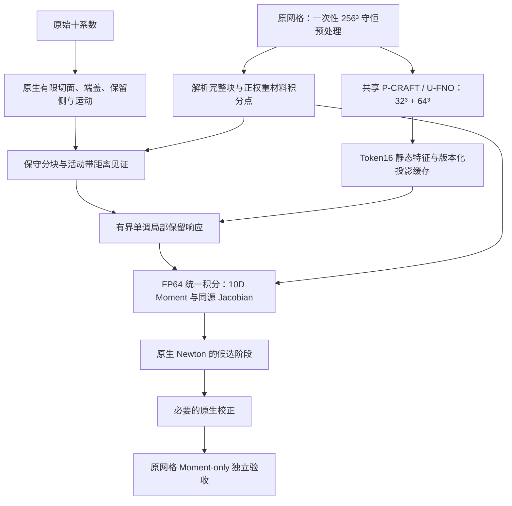

# Compact PINO V2.3：执行优化交付与组成架构

日期：2026-11-27（北京时间）

## 1. 交付结论

本轮交付可直接载入现有 V2.2 / E16 参数的 **CompactPINOv23 执行入口**，以及原生验收优化、运行记录、查询回放和数据覆盖工具。数学响应、参数布局、256³ 材料语义与原生验收阈值保持兼容。

**本轮完成代码优化与本机软件验证；没有重新训练新权重，也没有完成 5090 端到端提速认证。** 本机为 PyTorch 2.8.0 CPU 环境。Work B 可直接复用冻结 E16 开始配对验证，无需等 Work A 扩数、也无需先长训练。

文件导航：

- [Work A 数据与物理凭据交付清单](WORK_A_HANDOFF.md)
- [Work B 集成、配对复验与速度验收清单](WORK_B_HANDOFF.md)
- [实际架构与运行环境](evidence/architecture_cpu.json)
- [软件回归日志](evidence/software_validation.log)
- [原 Work 验收公式复算](evidence/work_acceptance_formula_replay.json)
- [CPU 表面执行微基准原始回执](evidence/surface_cpu_benchmark.json)

## 2. 实际组成架构

| 层 | 实现与职责 | 本轮状态 |
|---|---|---|
| 静态材料 | 256³ 守恒表示；完整体素解析矩、边界正权重积分；固定材料单独加一次 | 沿用已有物理表示 |
| 静态编码 | 共享 P-CRAFT / U-FNO，32³ + 64³ 多尺度；Token16；质量加权几何注意力 | 沿用权重，每件几何复用编码 |
| 响应静态投影 | 192 维 token 特征投影到局部响应第一层的 64 维线性项 | 新增受版本和容量约束的推理缓存 |
| 动态切面 | 原生有限、有向、带端盖切面；保留侧与原始系数运动链 | 保持语义，新增显式 M / joint 请求 |
| 动态几何执行 | 保守整块判定、活动带积分、BVH / 最近见证 | 沿用几何内核；新增跨 chunk 复用、按 CPU affinity 限制的执行器 |
| 局部响应 | 有界单调 monotone_warp；空间位置和静态上下文决定局部参数 | 沿用 E16 响应，没有独立 J 预测头 |
| 守恒积分 | 同一组正权重与局部保留率产生十矩及切割导数 | 新增 FP64 合并矩阵收缩；M-only 不计算响应 J |
| 求解接口 | raw 到 unit-coordinate 导数转换；候选与验收隔离 | 新增可关闭 callback、能力记录和逐阶段 trace |
| 原生验收 | 原网格 Boolean、原精确积分、原公式、原阈值 | 新增真正的材料 M-only；只缓存公式编译 |
| 审计 | 数据覆盖、曝光、拒绝、失败成本与计时边界 | 新增 CLI 和结构化回执 |

实际构造得到：**2,976,772 个总参数**；默认 response 训练模式 **12,674 个可训练参数**；Token16，上下文宽度 192，局部隐藏宽度 64，多尺度 32/64。详见 architecture_cpu.json。



当前几何注意力发生在静态编码阶段，查询依赖由有限切面与局部响应引入。不要把本实现描述成每次查询重新运行全量 Geometry–Physics Cross Attention。

十矩顺序保持：

\[
\phi(x,y,z)=(1,x,y,z,x^2,y^2,z^2,yz,xz,xy).
\]

\[
\widehat M=M_{\mathrm{fixed}}+M_{\mathrm{full}}+
\sum_{\ell\in\mathrm{active}}w_\ell r_\theta(x_\ell;c)\phi(x_\ell),
\qquad J=\frac{\partial\widehat M}{\partial c}.
\]

joint 请求使用同一个 basis 计算：

\[
[M_{\mathrm{active}},J]
=\Phi_w^\top[r,\partial r/\partial c].
\]

融合改变归约组织方式，不另设 J 网络。Full J 为 10×10；R3/R8 为各自有效坐标中的 10×3、10×8，不能用补零冒充 Full J。原生面运动、raw 系数归一化、有限端盖与有效 chart 链式求导保留。半带宽仍为一个体素；只有能保守证明完整保留/剔除的块走常量分支；几何歧义继续拒绝 joint。

## 3. 代码交付

核心目录：

research/NeuralMoments/models/pcraft_ufno/candidate_projects/quadrann_reproduction/spin_adapter/

| 文件 | 具体变更 |
|---|---|
| compact_pino_v23.py | 新类、RuntimeConfig、投影缓存、close 生命周期、运行统计 |
| v23_surface_runtime.py | 复用线程执行器、亲和限制、异常清理、显式绑定 |
| compact_pino_v21.py | 向后兼容的 fused / trace / execution_context 参数；准备与响应分段 |
| v21_response.py | 可选同源 M/J 融合收缩 |
| v21_response_surface.py | 表面绑定执行上下文；距离内核与见证规则不变 |
| v22_query_cache.py | 非零查询缓存也绑定模型执行器；资源不进入物理 key、不存运动 |
| v21_native.py | 按需运动请求、typed value 能力及明确 fallback |

生产原生文件 python/make_it_stand/verification/cherchi_inprocess.py 新增 evaluate_moments。它跳过交点运动恢复和材料切割 J；仍做 Boolean、精确十矩积分及本次证据生成。

| 本目录工具 | 用途 |
|---|---|
| deployment.make_predictor | 冻结 pack / checkpoint 的原生求解 callback |
| acceptance.verify | 独立原生验收，真实 M-only 或显式 joint fallback |
| replay_cli | 冻结 Noodles 查询序列的源构面与响应回放 |
| metrics | 查询时长、失败成本、生产/额外诊断计时核对 |
| coverage | manifest、资格、训练曝光审计 |
| surface_benchmark | 合成 CPU 执行器配对微基准 |
| verify_work_formula | SHA 锁定原 Work 函数的同进程数值复算 |

### 缓存与资源约束

- 在线默认 query_cache_bytes=0；同 q 的缓存命中不充当新 Newton 查询加速。
- 投影缓存最多一张 token table，默认 8 MiB，保留源 table 并核对版本及第一层权重版本。
- 权重载入、相关参数或设备变化、训练模式转换正确失效；训练不缓存可学习响应图。
- 冻结编码器的特征可跨 response 更新复用；编码器更新后旧特征拒绝使用。
- 非零 query cache 只存静态准备，不存当前运动、学习结果或训练图。
- 每个 V2.3 实例持有表面执行器；使用 with 或 close 释放，关闭后明确报错。

## 4. 接入方式

模型入口：

```python
import torch
from research.NeuralMoments.models.pcraft_ufno.candidate_projects.quadrann_reproduction.spin_adapter.compact_pino_v23 import (
    CompactPINOv23, RuntimeConfig,
)

with CompactPINOv23(
    token_grid=16, response_type="monotone_warp",
    training_scope="response", query_cache_bytes=0, full_cell_rule="tetra4",
    runtime=RuntimeConfig(surface_workers=None),
) as model:
    model.load_state_dict(checkpoint["model"], strict=True)
    model.to(device).eval()
    with torch.no_grad():
        features = model.encode_geometry(blocks, fixed_moments, density, inference=True)
        result = model.evaluate_operand(features, operand, with_jacobian=True)
```

示例变量由调用端按冻结协议提供。surface_workers=None 按实际 affinity 限制、最多 8；线程更多不等于更快。保留现有网络 dtype 和 FP64 物理归约。

Work callback：

```python
from experiments.compact_pino_v21.runtime_efficiency.deployment import make_predictor
from experiments.compact_pino_v21.runtime_efficiency.acceptance import verify

metadata = {}
with make_predictor(
    backend, pack, checkpoint_path, metadata,
    expected_geometry="noodles", expected_pack_sha256=frozen_pack_sha256,
    device="cuda:0", arm="v23",
) as evaluate:
    result = registered_solver(evaluate)

verified = verify(native_original_mesh_backend, q_final, request, result["status"])
```

registered_solver 是 Work 原有求解流程的示意名称，不是新增函数。继续用原初值、停止条件和原生校正。冻结 pack SHA 必须来自已绑定原网格/坐标的注册清单，不能用随手计算的 SHA 代替身份核验。

evaluate(q) 为完整 Newton callback；evaluate.evaluate(q, with_jacobian=False) 仅用于明确需要 M 的调用者，不是最终原网格验收。

### 实际省去的工作

| 请求 | 实际行为 |
|---|---|
| 神经 joint | 构面与运动、活动带响应、同源 M/J |
| 神经 M-only，全秩生产源 | 不计算响应 J；source 目前只有 motion 导出，构面运动成本仍存在 |
| 显式核验的 R3/R8 value extension | 可调用真实 source_value；不自动替换 map |
| 原生 evaluate_moments | 保留 Boolean/积分；跳过交点运动恢复和材料切割 J |
| 原生旧 backend | acceptance 明确 joint_fallback，不能记为真实 M-only |

最终验收仍需要目标/约束对十矩的梯度。省去的是该公式未使用的十矩对切割系数的 Jacobian。

## 5. 可运行回放

从仓库根目录、使用 Work 已核验的 Python/native launcher 执行；将路径和 SHA 换为真实冻结资产。

```bash
python -m experiments.compact_pino_v21.runtime_efficiency.replay_cli \
  --alignment /path/to/frozen_alignment \
  --corpus /path/to/frozen_corpus \
  --physics /path/to/frozen_physics \
  --pack /path/to/noodles_pack --pack-sha256 FROZEN_PACK_SHA256 \
  --checkpoint /path/to/E16_checkpoint.pt \
  --arm v23 --mode joint --device cuda:0 --passes 2 --threads 2 \
  --output /path/to/new_v23_replay
```

输出 query_traces.jsonl、predictions.json、summary.json，输出目录必须尚未存在，避免覆盖旧证据。v22 对照改 --arm 和输出目录；当前 v22 已共享公共执行器更新，**完整旧版对照另用冻结旧 commit**。

该 CLI 重新构造切面，不向模型输入保存的 Boolean 结果，但使用预建材料，且不跑闭环 Newton，因此不是冷启动合格解测速。它专用于已登记的 Noodles 原始系数轨迹；R3/R8 仍用受约束的既有回放入口。

默认 trace 各阶段是 host wall，设备等待可能归入后续阶段；输出转 CPU 后 callback 才结束。--profile-sync 是改变时序的诊断同步。正式端到端比较另跑无 trace 的完整路径。完整作业时间由外层 launcher 计量；replay_measurement_wall_s 不包含最终结果序列化。

```bash
python -m experiments.compact_pino_v21.runtime_efficiency.metrics \
  --queries /path/to/query_traces.jsonl --output /path/to/query_summary.json

python -m experiments.compact_pino_v21.runtime_efficiency.coverage \
  --manifest /path/to/current_manifest.json --verify-load --mode trial \
  --cache-directory /path/to/cache --output /path/to/coverage_verified.json
```

coverage 不重跑原生教师，不自动授予训练 GO；缺失字段和资格如实列出。

## 6. 验证与解释范围

本次合并后统一回归 **179 passed，2 个环境/pytest 配置警告，115.58 秒**，没有失败或跳过。完整日志、JUnit XML 与逐文件源码哈希随 evidence 交付；这是 CPU 软件回归，不是模型在 179 个真实几何上通过物理验收。

软件测试使用实际默认 32³/64³ 编码器，覆盖：

- state_dict 严格兼容，新查询、两侧、M-only 的 M/J 等价；
- 融合/非融合的上下文和参数梯度，真实联合训练的编码器/注意力/响应梯度；
- response-only 两次真实参数更新、缓存正确失效与编码器冻结复用；
- 非零 query cache 的资源归属、当前运动重算和关闭行为；
- 串并行见证一致、同面互补、运动有限差分、歧义拒绝；
- 原生 Python 有理积分的 joint/M-only 同矩，并禁止调用被省去的交点运动和导数；
- 原 Work verify 同进程 14 字段一致；归档失败点仍拒绝、校正点仍接受；
- 运行记录、拒绝、完整失败成本、覆盖和真实曝光的区分。

本机测试不能替代生产 Cherchi/GMP/MPFR、真实 E16 几何与 GPU 的完整闭环复验。

### 微基准完整保留了未提速的结果

12 面、16,384 点；两路径各 3 次预热、30 次测量：

| 路径 | 中位数 | P95 |
|---|---:|---:|
| 每次新建线程池 | 6.173 ms | 7.153 ms |
| 复用线程池 | 6.381 ms | 7.390 ms |

共享 CPU 上这次测量未显示提速；33 次调用只建一个池及数值一致得到验证。不能挑选此前更快的 stdout 单轮作为成绩；Work B 应以相同硬件配对实测选择 worker/fused 配置。

## 7. 后续决策

1. 直接用 E16 做执行等价配对和已知合格的混合路线复验，失败仍计成本。
2. Work A 并行定向补中保留终点、高保留跨来源、R8、实际 Newton Jv 和有效 Full J，不靠扩大随机查询池解决执行慢。
3. 根据分段瓶颈再决定早交接或快速学生；不以扩大静态编码器作为默认动作。当前没有交付已训练学生或已校准早交接阈值。
4. 工程等价版本保持物理质量、降低合格解耗时；不重新要求相对同一 E16 的 Moment 改善 5%。修改响应/数据的训练实验另行冻结协议。
5. Work 的硬件与物理复验通过后，才称部署优化完成；独立来源、多初值、成功率与配对时间证据完成后，才支持跨几何和论文级提升。
