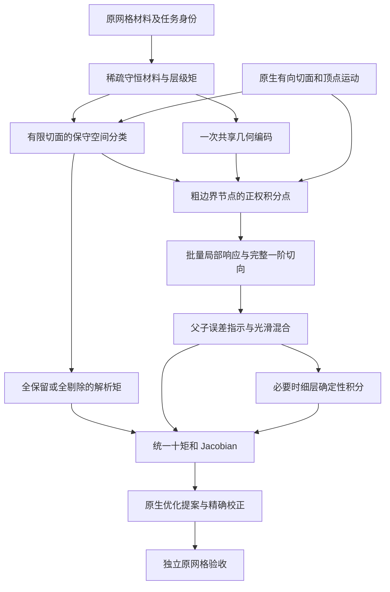

# HENMO V1+：层级边界神经矩算子

**当前执行入口（2026-11-28 旧配置隔夜失败后）：** [最新联合执行清单](WORK_EXECUTION_R3_2026-11-28.md)、[Work A数据清单](WORK_A_EXECUTION_R3_2026-11-28.md)、[Work B完整命令与通过条件](WORK_B_EXECUTION_R3_2026-11-28.md)。停止旧配置追加训练，先用现有权重核对数值与八路径/梯度，再运行有界短筛选。框架仍为HENMO R3，代码基线`74e47e7`；本次清单更新不代表新架构或已取得更好权重。方案依据保留在[R3优化方案](OPTIMIZATION_PLAN_R3_2026-11-27.md)。下文默认模型与历史训练入口仅供参考，当前执行顺序以上述11月28日清单为准。

本目录是从已发布 V2.4 代码构建的独立研究实现。目标是减少每次查询的材料积分和神经计算，同时保留有限切面语义、十矩守恒、同源一阶 Jacobian 与原网格最终验收。**代码可训练、可比较、可接入原生求解；本次软件验证不代表已经训练出合格生产权重，也不代表已经测得 GPU 加速。**

代码入口：`build_model("henmo_v1plus", config_overrides=config)`，或 `HENMOOperator(HENMOConfig(...))`。旧 Compact 模型的名称与默认配置保持原样。数据导出/读取的高分辨率支持是显式 opt-in，旧默认仍为 256。

## 1. 实际组成



| 部分 | 当前实现 | 对应代码 |
|---|---|---|
| 材料 | `PreparedMaterial` 的完整 RLE 区间与原网格边界正权积分点；显式支持 256/512/1024；不分配原生分辨率的稠密三维输入 | `henmo_hierarchy.py`，现有 `v21_material.py` |
| 层级 | 默认从 32³ 粗节点查询，到 64³ 叶节点；每节点存完整十矩、边界盒和层级关系 | `henmo_hierarchy.py` |
| 粗节点积分规则 | 流式正权压缩，默认每节点至多 32 点；完整材料零至二阶矩校验；压缩失败转确定性积分 | `henmo_cubature.py` |
| 共享编码 | P-CRAFT 多尺度 U-FNO 上下文 64³ + 128³，宽度 16、2 层；没有重复 GNO 支路 | `henmo_geometry.py`，`henmo_operator.py` |
| 局部几何 | 默认 32³ 特征表；节点内部 2×2×2 个子区域的 80 个矩特征，加节点位置/尺度，经小型网络编码 | `henmo_geometry.py`，`henmo_hierarchy.py` |
| 注意力 | 一次材料质量加权全局摘要；查询中局部材料与有限切面 token 的交叉注意力 | `henmo_response.py` |
| 边界响应 | 有界 `compact_warp`，输出每个正权点的保留率；保留旧 `bounded_residual` 作为消融 | `henmo_response.py` |
| 一阶导数 | 显式切向传播，含切面运动、距离、切面 token、注意力及混合门控；来自最终同一个 Moment | `henmo_response.py`，`henmo_execution.py`，`henmo_operator.py` |
| 实际批量执行 | 同带宽的边界 stencil 组成受限 wave，一次响应/切向调用，FP64 批量矩阵乘聚合 | `henmo_execution.py` |
| 细化 | 父子粗积分差作为经验指示器；混合包含门控导数；必要时原生细胞 GL3 积分 | `henmo_operator.py` |
| 训练 | 合格 Moment/J 分开归一化和计数；随机粗层级训练；完整断点、实际更新计数与语义迁移 | `training.py`，`migration.py` |
| 部署 | 冻结任务与 checkpoint 注册；同一原生 solver 回调；精确校正、失败记账与独立验收 | `deployment.py` |

**三个分辨率互不等同**：材料侧 512/1024 不等于上下文网格 64/128，也不等于每次查询遍历 512³/1024³ 个体素。128 是全局几何上下文的较细尺度；查询大部分工作停在粗节点。增加材料分辨率只能改善材料表示，不能替代局部响应训练或证明任意切割准确。

## 2. 保持的物理与数值契约

十矩顺序固定为：

`[m, x, y, z, xx, yy, zz, yz, xz, xy]`。

对固定材料与可编辑材料：

\[
\widehat M = M_{\rm fixed}+\sum_{n\in\mathcal I}M_n+
\sum_{n\in\mathcal B}\sum_{\ell} w_{n\ell}r_{n\ell}\phi(x_{n\ell}),
\qquad w_{n\ell}\geq0,\quad 0\leq r_{n\ell}\leq1.
\]

`J = dM/dc` 包含最终混合响应的全部一阶链式项。粗积分点保持完整材料十矩，但不因此获得所有切割的精确积分。`Exact Interior` 的“精确”限于已登记材料表示、浮点容差和经过保守空间判断的区域；它不是连续网格任何拓扑的零误差承诺。

本实现直接使用部署构造的**有限、有向、带端盖切面**，用有符号距离的空间界分类；没有将其替换成无限二次曲面的符号测试。互补性只对应同一个切面的 intersection/difference：包含固定材料时两次输出相加是 `2*M_fixed + M_editable`。没有重新引入跨两次独立构面的反号互补硬约束，也没有未经验证地强制原始系数球面尺度不变性。

完整保留/剔除的常量分支必须覆盖响应的全部支撑。压缩后的点稀疏，如果仍只用一个原生体素宽的响应带，切面可能落在全部点的响应带之外。因此粗响应默认使用 `max(native_width, node_diameter)` 的支撑；细层确定性积分使用原生带宽。两者差异接受独立标签与细化诊断检查，**较宽支撑不被当作硬切割真值**。

人工的父子层级切换使用光滑混合。父子差的归一化平方为 `u`，在冻结的 `[blend_start, blend_end]` 区间用 cubic smoothstep 权重；Jacobian 包含 `dalpha/dc * (M_fine-M_coarse)`。Jacobian 差用于报告/拒绝提案，不能作为隐藏的不可微混合开关。父子一致并不证明它们共同接近真实切割，指标明确标记为非误差证书。

真实接触、最近面歧义与拓扑事件不能由“光滑”自动解决。没有合格导数时返回 `J=None` 并要求原生处理。Moment-only 调用返回 `MOMENT_ONLY_REQUIRES_NATIVE_ACCEPTANCE`，不会冒充 Newton 可用的完整提案。

## 3. 默认配置与使用入口

在仓库根目录执行。正式工作使用 Work 环境已有的 PyTorch/CUDA、SciPy、NumPy 与原生切割依赖；软件 fixture 无需生产数据。

```bash
python -m experiments.henmo_v1plus.cli --help
python -m experiments.henmo_v1plus.cli smoke --output /absolute/new/henmo-smoke
```

软件 smoke 使用实际共享编码器和新响应，完成两个逻辑更新，从第一步恢复并再次执行第二步；比较下一步权重。它使用解析立方体监督，明确标记 `synthetic_software_only`。

预置配置在 `configs/`：

- `pilot256.json`：优先复用现有已获准 256 材料快照进行实现对照。
- `pilot512.json`：默认高分材料研究候选。
- `pilot1024.json`：薄壁/精细结构的表示敏感性对照；不要求所有几何强制升分辨率。
- `e16_compatible.json`：旧响应语义与旧编码布局的显式迁移对照。
- `cpu_smoke.json`：微型软件环境，不能当作正式模型配置。
- `training_pilot.json`：seed 830251、Adam 学习率 3e-5、batch 1、M/J 权重 1、辅助物理损失 0、312 次实际更新、最多 624 attempts。

亦可通过 `cli config --profile pilot512 --output ...` 生成配置。正式候选默认 FP32 网络、FP64 矩聚合，不启用未经验证的 AMP。高分辨率编码的 GPU 内存和速度必须在目标机器测量后才能提高 batch。

```bash
python -m experiments.henmo_v1plus.cli audit-data \
  --manifest /absolute/frozen/training_manifest.json \
  --config experiments/henmo_v1plus/configs/pilot512.json \
  --mode trial --output /absolute/new/data-audit.json

CUBLAS_WORKSPACE_CONFIG=:4096:8 python -m experiments.henmo_v1plus.cli train \
  --manifest /absolute/frozen/training_manifest.json \
  --config experiments/henmo_v1plus/configs/pilot512.json \
  --training-config experiments/henmo_v1plus/configs/training_pilot.json \
  --mode trial --device cuda:0 --dtype float32 \
  --evaluate-every 104 --output /absolute/new/henmo-pilot

CUBLAS_WORKSPACE_CONFIG=:4096:8 python -m experiments.henmo_v1plus.cli compare \
  --manifest /absolute/frozen/training_manifest.json \
  --config experiments/henmo_v1plus/configs/pilot512.json \
  --checkpoint /absolute/henmo-pilot/selected.pt \
  --mode trial --device cuda:0 --dtype float32 \
  --output /absolute/new/paired-queries.json
```

所有输出路径是用户需要替换的示例；`train` 使用新空目录，续训也写入新会话目录。checkpoint 的原始快照、科学配置、精度与 sidecar 哈希必须一致。这里的 `compare` 是同快照开发对照，跨快照独立几何走部署注册与独立验收流程。

CUDA 的训练和比较入口均启用确定性算法，因此示例在启动进程前设置 `CUBLAS_WORKSPACE_CONFIG`。若实际 GPU/算子仍报告不支持确定性执行，应保留错误并处理，不要为跑通而静默关闭确定性检查。

`--resume` 表示恢复同一个冻结运行，包括原来的 `max_steps`、`max_attempts`、学习率、batch 和随机状态；不能同时修改预算或数据快照。已经完成 312 步的 checkpoint 用同一配置恢复后不会自动继续训练。增加预算、改变训练范围或数据应建立单独登记的新阶段，按语义迁移初始化并明确重新建立 optimizer，不能称为精确续训。`--mode long` 只是现有真实数据加载模式，不会增加训练预算或签发长训资格。

HENMO 的选模规则单独记录初始/恢复权重作为保底 incumbent，并区分是否产生新更新。它不声称重放旧 V2.1 只从 104/208/312 步选候选的预注册结果。初始权重胜出不算新模型晋级。默认训练预算是实现与方向筛选，不能自动升为长训练。

`selected_has_new_updates` 是相对本次 `selection_scope.start_step` 判断的：恢复后仍保留恢复时权重，该字段也为 false，即使这些权重在此前运行中已训练过。当前续训报告不会声称恢复了此前所有评估节点的历史最优排序。

## 4. 对照与真正端到端证据

`cli compare` 在相同材料、有限切面、标签上比较 GL2、GL3 确定性平滑响应积分与 HENMO；它报告共享材料/层级准备、候选编码和各查询计时。GL2/GL3 不是精确硬布尔，也不是所有传统局部截断算法的上界。论文级结论还需要部署原网格精确方法，以及按误差调节精度的强确定性基线。

第一轮必须回答：新响应是否优于无学习响应；粗层是否减少了实际活跃点和神经调用；自适应是否因频繁落入细层而失去收益；高保留、末段与不同来源上的误差是否恶化。仅报告单次查询时间或预估矩误差不能证明求解加速。

完整求解比较使用同一原生 solver、相同初值与停止条件，包含冷启动网格读取/预处理、构面、传输、推理、失败、精确校正与独立验收。`paired_solve_report` 拒绝把不完整计时或未通过物理验收的候选当作有效加速。少量来源的置信区间只覆盖这些来源，不自动支持泛化结论。

## 5. 权重、缓存及导数训练

E16 只能通过源 SHA256、模块语义、坐标/归一化、形状和 dtype 校验迁移。新边界头不能因为张量形状碰巧相同就载入旧头。新头零初始化时，第一步主要更新末层；后续编码器梯度需要真实更新核验，测试另用非零初始化检查完整 J 损失路径。

材料与压缩积分规则可长期缓存；学习得到的全局/局部特征以 encoder 参数、buffer 版本与图生命周期为键。参数更新、设备变化和载入权重使相应缓存失效。一个训练图不能反复 backward；冻结编码器可按版本复用静态特征。

Moment 的物理尺度是 `m*L^k`；Jacobian 还乘原始系数/受限 chart 的参数尺度。缺失或不合格 R3/R8/Full-J 不补零，不进入合格导数分母。新训练器复用原有已归一化损失，不重复“修复”不存在于当前路径的旧尺度问题。

## 6. 完成范围

核心代码、真实更新/恢复测试与对照入口已提供；逐项证据见 `IMPLEMENTATION_AUDIT.md`。Work A 负责原始材料、教师、资格与来源覆盖；Work B 负责目标 GPU 实测、训练和求解闭环。

尚不能由本地 CPU 软件检查证明：生产数据上的精度、RTX 5090 的毫秒性能、原生校正只需固定步数、相对原论文的端到端加速、独立几何成功率。当前多起点调度是有界串行可选路线，**没有实现或宣称 64/128 条完整优化轨迹的一次 GPU 批量求解**。树遍历、有限面最近点查询与部分自适应调度仍在 CPU/Python；是否继续专门优化它们由真实剖析决定。

交付指南：

- `WORK_A_ACTION_GUIDE.md`
- `WORK_B_ACTION_GUIDE.md`
- `DEPLOYMENT_GUIDE.md`
- `IMPLEMENTATION_AUDIT.md`
